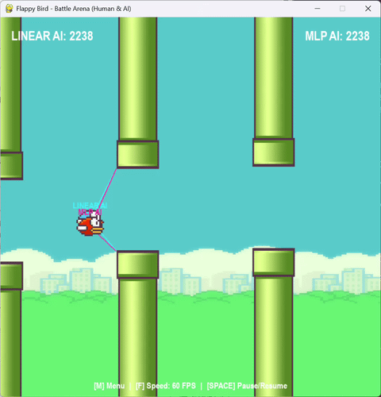

# 🐦 Flappy Bird AI — Neuroevolution with Genetic Algorithm

<div align="center">


**Training two AI agents — a Linear Perceptron and a Multi-Layer Perceptron — to master Flappy Bird using a custom Genetic Algorithm, with no reinforcement learning or backpropagation.**

</div>

---

## 📸 Demo



---

## 🎯 Project Overview

This project applies **Neuroevolution** to solve the classic Flappy Bird game. Instead of gradient-based learning, two neural network architectures evolve their weights through a **custom Genetic Algorithm (GA)** — survival of the fittest, generation by generation.

Two AI "brains" are implemented and trained independently, then compete head-to-head:

| Model | Architecture | Parameters | Training Method |
|-------|-------------|------------|-----------------|
| **Linear Bird** 🔵 | Single-layer Perceptron | 6 | Genetic Algorithm |
| **MLP Bird** 🔴 | 3-layer MLP (5→8→4→1) | 89 | Genetic Algorithm |

**Key idea:** The GA encodes each neural network's weights as a *chromosome* (a list of floats). Crossover, mutation, and selection pressure evolve the population across generations until a bird can survive indefinitely.

---

## ✨ Key Highlights

- 🧬 **Genetic Algorithm from scratch** — no NEAT library, no external EA framework
- 🧠 **Two neural architectures compared** — simple Perceptron vs deep MLP, both trained by evolution
- 🔁 **BLX-α Crossover** — blend crossover explores the gene space beyond parent bounds
- 🏆 **Elitism** — the best individual is always preserved across generations
- 🎮 **3-mode interactive arena** — AI vs AI, User vs Linear Bird, User vs MLP Bird
- ⚡ **Fast-forward training** — toggle max-speed mode with `[F]` key
- 📐 **Physics-matched evaluation** — play mode exactly mirrors training physics for fair AI comparison
- 💾 **Auto-checkpoint saving** — best chromosome saved to JSON when score milestone is reached

---

## 🏗️ Architecture Deep Dive

### Input Features (5 normalized inputs)

Each bird receives 5 real-valued inputs at every frame:

| # | Feature | Formula | Normalized By |
|---|---------|---------|---------------|
| 1 | Bird vertical center | `bird.y + height/2` | `SCREEN_HEIGHT` |
| 2 | Bird velocity | `bird.velocity` | `10.0` |
| 3 | Distance to next pipe | `pipe.x − (bird.x + width)` | `SCREEN_WIDTH` |
| 4 | Distance to top pipe | `bird.y − pipe.height` | `SCREEN_HEIGHT` |
| 5 | Distance to bottom pipe | `(pipe.height + gap) − (bird.y + height)` | `SCREEN_HEIGHT` |

**Decision rule:** If `output > 0.5` AND `velocity > 0` → flap. Otherwise, free fall.

---

### Model 1: Linear Perceptron (`LinearBrain`)

A single-layer perceptron — the simplest possible decision-making model.

$$\hat{y} = \sigma\!\left(\sum_{i=1}^{5} w_i x_i + b\right)$$

- **6 parameters:** 5 weights + 1 bias
- **Implemented in:** `model_brain/linear_brain.py` using **NumPy** only
- **Chromosome:** `[w1, w2, w3, w4, w5, b]`

```
Input (5) ──[ w·x + b ]──► Sigmoid ──► output ∈ (0,1)
```

---

### Model 2: Multi-Layer Perceptron (`MlpBrain`)

A deeper network that can learn non-linear decision boundaries.

```
Input(5) ──► FC(5→8) ──► ReLU ──► FC(8→4) ──► ReLU ──► FC(4→1) ──► Sigmoid ──► output ∈ (0,1)
```

- **89 parameters:** (5×8+8) + (8×4+4) + (4×1+1) = 48 + 36 + 5 = **89**
- **Implemented in:** `model_brain/mlp_brain.py` using **PyTorch** (`nn.Module`)
- **Weight injection:** `nn.utils.vector_to_parameters()` maps the flat chromosome vector into all layers

> [!NOTE]
> The MLP is **never trained by backpropagation**. The GA treats the entire 89-weight array as a single chromosome, evolving it purely through selection, crossover, and mutation — a technique known as **Neuroevolution of Augmenting Topologies (NEAT)-adjacent** approach.

---

## 🧬 Genetic Algorithm Pipeline

```
┌─────────────────────────────────────────────────────────┐
│                   GENERATION  N                         │
│                                                         │
│  Population (100 birds, random chromosomes)             │
│         │                                               │
│         ▼                                               │
│  [ Simulate all birds in parallel ]                     │
│  Fitness = score × 100 + time_alive                     │
│         │                                               │
│         ▼                                               │
│  Selection ── Top 50% survive                           │
│         │                                               │
│         ├──► Elite (best bird copied unchanged)         │
│         │                                               │
│         └──► Crossover (BLX-α, α=0.2) + Mutation       │
│              ┌─────────────────────────────────┐        │
│              │ For each gene gᵢ:               │        │
│              │   range = [min-0.2d, max+0.2d]  │        │
│              │   child_gᵢ ~ Uniform(range)     │        │
│              │                                 │        │
│              │ Mutation: 10-15% genes shift    │        │
│              │   Δgᵢ ~ Gauss(0, σ)             │        │
│              └─────────────────────────────────┘        │
│                                                         │
│  New Population ──► GENERATION N+1                      │
└─────────────────────────────────────────────────────────┘
```

| Hyperparameter | Linear Bird | MLP Bird |
|---------------|-------------|----------|
| Population size | 100 | 100 |
| Mutation rate | 10% | 15% |
| Mutation sigma (σ) | 0.3 | 0.2 |
| Crossover | BLX-α (α=0.2) | BLX-α (α=0.2) |
| Elitism | ✅ Top 1 | ✅ Top 1 |

> [!TIP]
> MLP uses a slightly higher mutation rate but lower sigma — a wider search net with smaller per-step jumps, which helps navigate a larger 89-dimensional gene space without overshooting.

---

## 📂 Project Structure

```
flappy-bird-game/
│
├── 📄 config.py               # All constants (screen, physics, GA params)
│   │                          #   LinearConfig / MlpConfig classes
│   └──                        #   Auto-creates checkpoints/ on import
│
├── 📄 entities.py             # Bird base class + LinearBird / MlpBird / Tube
│   │                          #   get_inputs() — 5 normalized sensor features
│   └──                        #   save_best_bird() / load_best_bird() on Bird
│
├── 📄 genetic_algorithm.py    # GeneticAlgorithm class
│   │                          #   selection(), crossover(), mutate()
│   └──                        #   next_generation() — auto-detects Linear vs MLP
│
├── 📄 train.py                # Main training loop (Pygame visualization)
│   └──                        #   Set MODEL_TYPE = "linear" | "mlp" to choose model
│
├── 📄 play_flappy_bird.py     # Interactive play — 3 game modes
│
├── 📁 model_brain/
│   ├── linear_brain.py        # LinearBrain (NumPy dot product + sigmoid)
│   └── mlp_brain.py           # MlpBrain (PyTorch nn.Module, 3-layer MLP)
│
├── 📁 checkpoints/
│   ├── best_bird_linear.json  # Saved Linear chromosome (6 floats)
│   └── best_bird_mlp.json     # Saved MLP chromosome (89 floats)
│
├── 📁 assets/                 # Sprites (bird PNGs, pipe, background)
└── 📄 requirements.txt
```

---

## 🚀 Quick Start

### 1. Installation

```bash
git clone https://github.com/YOUR_USERNAME/flappy-bird-game.git
cd flappy-bird-game
pip install -r requirements.txt
```

### 2. Train an AI

Open `train.py` and set the model type:

```python
MODEL_TYPE = "linear"   # or "mlp"
```

Then run:

```bash
python train.py
```

Training controls:

| Key | Action |
|-----|--------|
| `F` | Toggle max-speed / 60 FPS mode |
| `SPACE` | Pause / Resume |

Training auto-saves the best chromosome to `checkpoints/` when the score milestone is reached.

### 3. Watch the AI Play

```bash
python play_flappy_bird.py
```

Select a game mode from the menu:

| Mode | Description |
|------|-------------|
| **1 — AI vs AI** | Linear Bird 🔵 vs MLP Bird 🔴 compete simultaneously |
| **2 — User vs Linear** | You 🟡 play against the trained Linear Bird 🔵 |
| **3 — User vs MLP** | You 🟡 play against the trained MLP Bird 🔴 |

Play controls:

| Key | Action |
|-----|--------|
| `SPACE` | Flap (user bird) |
| `F` | Toggle fast mode (AI vs AI only) |
| `M` or `ESC` | Return to mode selection menu |

---

## 🛠️ Tech Stack

| Library | Version | Usage |
|---------|---------|-------|
| Python | 3.10+ | Core language |
| Pygame | ≥ 2.5.0 | Game engine & visualization |
| NumPy | ≥ 1.24.0 | Linear perceptron math |
| PyTorch | ≥ 2.0.0 | MLP architecture (`nn.Module`) |

> [!IMPORTANT]
> PyTorch is used **only as an MLP container** — not for autograd or optimizer. All learning happens through the Genetic Algorithm.

---

## 📊 Model Comparison

| Attribute | Linear Perceptron | MLP (3-layer) |
|-----------|------------------|---------------|
| Parameters | **6** | **89** |
| Expressiveness | Linear boundary | Non-linear boundaries |
| Convergence speed | Very fast | Slower (larger search space) |
| Training stability | High | Medium |
| Framework | NumPy | PyTorch |
| Chromosome size | 6 floats | 89 floats |
| Bird color | 🔵 Blue | 🔴 Red |

---

## 💡 Why This Project Matters

This project demonstrates several important concepts at the intersection of **game AI**, **evolutionary computation**, and **software engineering**:

1. **Neuroevolution** — using evolution to train neural networks, an alternative to gradient descent
2. **Comparative model design** — same GA, same game, two architectures → empirical insight into model complexity vs. trainability
3. **Clean OOP architecture** — `Bird` base class with polymorphic `LinearBird` / `MlpBird` subclasses; GA is model-agnostic via `type()` detection
4. **Physics-faithful evaluation** — synchronizing play mode with training loop prevents the trained policy from performing worse in deployment
5. **No external AI libraries** — the entire learning pipeline (selection, crossover, mutation, fitness) is implemented from scratch

---

## 🔭 Future Work

- [ ] **NEAT (NeuroEvolution of Augmenting Topologies)** — evolve topology as well as weights
- [ ] **Real-time fitness graph** — live Matplotlib/Pygame plot of best fitness per generation
- [ ] **More input features** — e.g., distance to 2nd pipe, angular velocity
- [ ] **Multi-objective fitness** — balance score, smoothness, and energy
- [ ] **Species diversity** — prevent premature convergence through speciation
- [ ] **Hyperparameter sweep** — systematic comparison of mutation rates and population sizes

---

## 📄 License

This project is licensed under the MIT License — see [`LICENSE`](LICENSE) for details.

---

<div align="center">
Made with ❤️ and evolution
</div>
